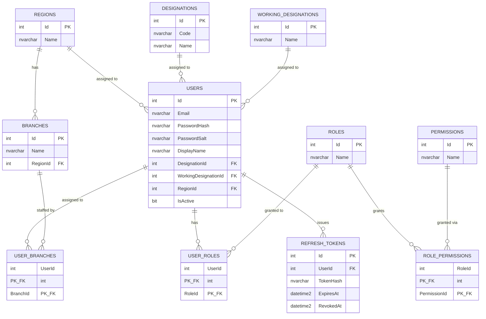

# TransitCore Database

Hand-written T-SQL for SQL Server, run manually in SSMS (or `sqlcmd`). No ORM
migrations — these scripts are the source of truth for schema.

**Status:** Identity, Lookup, Ops (VehicleOrderMapping), and the full
Fleet/Ops/Billing domain schema + seed data are in place. Not every table has
a corresponding stored procedure yet — see "What's schema-only so far" below.
Built alongside the TransitCore.Api rewrite slice by slice; see `/PLAN.md` at
the repo root for the full sequencing.

**Verified against a live SQL Server** (LocalDB) — `run-all.sql` executes
clean end to end, all 37 tables/35 procs created, seed data loads, and the
full stack (SQL Server → stored procs → TransitCore.Api → TransitCore.Web)
was exercised for real: login, paginated vehicle/trip listings, fleet
utilisation, invoice summary. Two real bugs were only caught this way and
are now fixed:
- **The `identity` schema name doesn't work** — `IDENTITY` is a reserved
  T-SQL keyword; `CREATE SCHEMA identity` (and every `identity.Table`
  reference) fails outright unless bracket-quoted. Renamed the schema to
  `auth` everywhere (schema/table/proc/TVP definitions, seed data, and the
  two C# repositories that called these procs by name) rather than
  bracket-quoting every reference.
- `DATEADD(HOUR, ...)` can't apply an hour offset directly to a `DATE`-typed
  expression (only DATETIME/DATETIME2) — fixed in the trip seed script by
  casting to `DATETIME2` first.

## What's schema-only so far

Tables exist (with indexes/constraints) but have no CRUD procedures or seed
data yet: `fleet.VehicleDocuments`, `fleet.MaintenanceRecords`,
`fleet.FuelLogs`, `fleet.DriverLicenses`, `fleet.DriverAssignments`,
`billing.CustomerContacts`, `billing.CustomerAddresses`, `ops.RouteStops`,
`billing.RateCards`. These will get procedures + seed data (and .NET
endpoints) as the corresponding UI screens are built, rather than being
built speculatively ahead of a consumer. (`ops.Shipments`/`ShipmentItems`
got procedures, seed data, and a UI screen once the Shipments list/create
screen was added.)

## Prerequisites

- SQL Server 2019+ (developed against SQL Server's current T-SQL surface;
  no version-specific syntax used beyond `STRING_AGG`, which needs 2017+).
- A database named `TransitCoreDb` must already exist:
  ```sql
  CREATE DATABASE TransitCoreDb;
  ```
- SSMS with **SQLCMD Mode** enabled (Query menu → SQLCMD Mode) if running
  `run-all.sql`, since it uses `:r` include directives. Alternatively, run
  each file in the order below individually — every script is idempotent, so
  re-running any of them is safe.

## Run order

```
01-schema/001_lookup_core.sql
01-schema/002_identity_schema.sql
02-programmability/001_identity_procs.sql
03-seed/001_lookup_seed.sql
03-seed/002_identity_seed.sql
```

Or just run `run-all.sql` from this folder in SQLCMD mode.

## Key strategy

`INT IDENTITY` on every table. Nothing in this system syncs across databases
or generates IDs client-side, so `UNIQUEIDENTIFIER` would only add index
bloat and worse join performance for no benefit here.

## Conventions

- Explicit schemas always (`auth.`, `lookup.`, `fleet.`, `ops.`, `billing.`).
  Never unqualified/`dbo.` for business tables. The identity domain's schema
  is named `auth`, not `identity` — `IDENTITY` is a reserved T-SQL keyword
  and breaks as an unquoted schema qualifier (confirmed against a live SQL
  Server: `CREATE SCHEMA identity` fails outright).
- Named constraints: `PK_Table`, `FK_Child_Parent`, `UQ_Table_Column`,
  `IX_Table_Column`, `CK_Table_Rule`, `DF_Table_Column` for defaults.
- Every business table has `CreatedAt`, `CreatedBy`, `ModifiedAt`,
  `ModifiedBy`, `IsDeleted` (soft delete).
- Every script is idempotent: `IF NOT EXISTS (...)` guards for
  tables/indexes/schemas, `DROP ... IF EXISTS` before `CREATE` for
  procedures, `MERGE` for seed data.
- No cascading deletes on anything that isn't a pure child-ownership
  relationship scoped to one aggregate (e.g. `UserRoles`/`RolePermissions`
  rows die with their `User`/`Role`, but a `Branch` is never deleted just
  because a `User` referencing it is).

## Password hashing

`auth.Users.PasswordHash`/`PasswordSalt` are PBKDF2-HMACSHA256 output
(100,000 iterations, 16-byte salt, 32-byte derived key), both stored as
Base64. The comparison happens in `TransitCore.Infrastructure.Security.PasswordHasher`
(.NET), not in T-SQL — `auth.usp_GetUserForLogin` only returns the stored
hash/salt for the app layer to verify. This keeps the hashing parameters easy
to change later without a database migration.

Demo users seeded by `03-seed/002_identity_seed.sql` (local/dev only —
rotate before using in any shared environment):

| Email | Password | Role |
|---|---|---|
| admin@transitcore.local | Admin@123 | Admin |
| manager@transitcore.local | Manager@123 | Manager |
| ops@transitcore.local | User@123 | User |

## ER diagram — Identity / core Lookup



## ER diagram — Fleet / Ops / Billing

```mermaid
erDiagram
    VEHICLE_TYPES ||--o{ VEHICLES : "classifies"
    VEHICLES ||--o{ VEHICLE_DOCUMENTS : "has"
    VEHICLES ||--o{ MAINTENANCE_RECORDS : "has"
    VEHICLES ||--o{ FUEL_LOGS : "has"
    VEHICLES ||--o{ DRIVER_ASSIGNMENTS : "assigned via"
    DRIVERS ||--o{ DRIVER_LICENSES : "holds"
    DRIVERS ||--o{ DRIVER_ASSIGNMENTS : "assigned via"
    CITIES ||--o{ ROUTES : "origin/destination"
    ROUTES ||--o{ ROUTE_STOPS : "has"
    ROUTES ||--o{ TRIPS : "scheduled on"
    VEHICLES ||--o{ TRIPS : "runs"
    DRIVERS ||--o{ TRIPS : "drives"
    TRIPS ||--o{ TRIP_STATUS_HISTORY : "has"
    TRIPS ||--o{ SHIPMENTS : "carries"
    CUSTOMERS ||--o{ SHIPMENTS : "requests"
    CUSTOMERS ||--o{ CUSTOMER_CONTACTS : "has"
    CUSTOMERS ||--o{ CUSTOMER_ADDRESSES : "has"
    SHIPMENTS ||--o{ SHIPMENT_ITEMS : "contains"
    UNITS_OF_MEASURE ||--o{ SHIPMENT_ITEMS : "measured in"
    CUSTOMERS ||--o{ INVOICES : "billed"
    INVOICES ||--o{ INVOICE_LINES : "has"
    SHIPMENTS ||--o{ INVOICE_LINES : "billed via"
    INVOICES ||--o{ PAYMENTS : "receives"
    CUSTOMERS ||--o{ RATE_CARDS : "priced by"

    VEHICLE_TYPES {
        int Id PK
        nvarchar Name
        decimal CapacityKg
    }
    VEHICLES {
        int Id PK
        nvarchar RegistrationNo
        int VehicleTypeId FK
        int StatusId FK
    }
    VEHICLE_DOCUMENTS {
        int Id PK
        int VehicleId FK
        nvarchar DocumentType
        date ExpiryDate
    }
    MAINTENANCE_RECORDS {
        int Id PK
        int VehicleId FK
        date ServiceDate
        decimal Cost
    }
    FUEL_LOGS {
        int Id PK
        int VehicleId FK
        date FuelDate
        decimal Liters
    }
    DRIVERS {
        int Id PK
        nvarchar FullName
        int StatusId FK
    }
    DRIVER_LICENSES {
        int Id PK
        int DriverId FK
        nvarchar LicenseNo
        date ExpiryDate
    }
    DRIVER_ASSIGNMENTS {
        int Id PK
        int DriverId FK
        int VehicleId FK
        date StartDate
        date EndDate
    }
    ROUTES {
        int Id PK
        nvarchar Name
        int OriginCityId FK
        int DestinationCityId FK
        decimal DistanceKm
    }
    ROUTE_STOPS {
        int Id PK
        int RouteId FK
        int CityId FK
        int StopOrder
    }
    TRIPS {
        int Id PK
        int RouteId FK
        int VehicleId FK
        int DriverId FK
        datetime2 ScheduledDeparture
        datetime2 ScheduledArrival
        int StatusId FK
    }
    TRIP_STATUS_HISTORY {
        int Id PK
        int TripId FK
        int StatusId FK
        datetime2 ChangedAt
    }
    CUSTOMERS {
        int Id PK
        nvarchar Code
        nvarchar Name
    }
    CUSTOMER_CONTACTS {
        int Id PK
        int CustomerId FK
        nvarchar ContactName
    }
    CUSTOMER_ADDRESSES {
        int Id PK
        int CustomerId FK
        int CityId FK
    }
    SHIPMENTS {
        int Id PK
        int TripId FK
        int CustomerId FK
        int OriginCityId FK
        int DestinationCityId FK
        int StatusId FK
        date ShipmentDate
    }
    SHIPMENT_ITEMS {
        int Id PK
        int ShipmentId FK
        nvarchar Description
        decimal Quantity
        int UnitOfMeasureId FK
    }
    RATE_CARDS {
        int Id PK
        int CustomerId FK
        decimal RatePerKg
        decimal RatePerKm
        date EffectiveFrom
    }
    INVOICES {
        int Id PK
        nvarchar InvoiceNo
        int CustomerId FK
        date InvoiceDate
        decimal TotalAmount
        int StatusId FK
    }
    INVOICE_LINES {
        int Id PK
        int InvoiceId FK
        int ShipmentId FK
        decimal LineTotal
    }
    PAYMENTS {
        int Id PK
        int InvoiceId FK
        date PaymentDate
        decimal Amount
    }
    CITIES {
        int Id PK
        nvarchar Name
        int CountryId FK
    }
    UNITS_OF_MEASURE {
        int Id PK
        nvarchar Code
        nvarchar Name
    }
```


